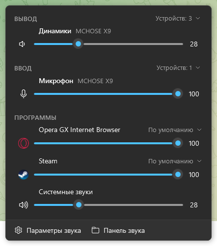

# AudioHub

Управление звуком Windows из трея: устройства, громкость каждой программы и своё устройство вывода для отдельной программы. Всё в одной панели, по одному клику по значку у часов.

<p align="center">
  
</p>

## Возможности

- **Устройства вывода и ввода.** Громкость, mute и индикатор уровня для основного устройства. По кнопке «Устройств: N» открывается список, клик по строке делает устройство основным (сразу для звука, мультимедиа и связи).
- **Микшер по программам.** У каждой программы, которая выводит звук, есть иконка, громкость, mute и живой уровень сигнала. Системные звуки тоже здесь.
- **Своё устройство для программы.** Например, Discord в наушники, а игра в колонки. Делается через меню «По умолчанию ▾» в строке программы.
- **Значок в трее** показывает текущую громкость, а при наведении пишет устройство и процент.
- **Тема как в Windows**: светлая или тёмная, с системным акцентным цветом. Если сменить тему, панель перекрасится сама.
- **Автозапуск** вместе с Windows, без прав администратора.

## Установка

Скачайте exe со страницы [Releases](../../releases/latest):

| Файл | Размер | Что нужно |
|---|---|---|
| `AudioHub-<версия>-win-x64.exe` | ~70 МБ | Ничего, работает сразу |
| `AudioHub-<версия>-win-x64-small.exe` | ~0,3 МБ | Установленный [.NET 8 Desktop Runtime](https://dotnet.microsoft.com/download/dotnet/8.0) (x64) |

Положите файл в любую постоянную папку и запустите. Окна не будет, появится значок динамика в трее. Чтобы программа запускалась вместе с Windows, кликните по значку правой кнопкой и отметьте «Запускать вместе с Windows». Если потом переместите exe, отметку нужно поставить заново.

Нужна Windows 10 или 11 x64.

## Как пользоваться

| Действие | Что произойдёт |
|---|---|
| Левый клик по значку в трее | Открыть или закрыть панель |
| Правый клик по значку | Меню: параметры звука Windows, классическая панель звука, автозапуск, выход |
| Колесо мыши над ползунком | Громкость ±2% |
| Клик по значку динамика или иконке программы | Mute или вернуть звук |
| «Устройств: N» | Выбрать основное устройство |
| «По умолчанию ▾» у программы | Выбрать, куда идёт звук этой программы |
| Esc или клик мимо панели | Закрыть панель |

## Что нужно знать

- **Закреплённая программа не следует за основным устройством.** Если программе выбрано конкретное устройство, её звук пойдёт туда, даже когда вы переключите основное. В панели такое устройство подсвечено акцентным цветом. Чтобы программа снова следовала за основным, выберите «По умолчанию».
- **Устройство можно закрепить только за программой, которая уже выводит звук.** Windows хранит эту настройку для приложения и помнит её после перезапуска. Это та же настройка, что в «Параметры → Звук → Громкость приложений».
- **Закрепление работает через недокументированный интерфейс Windows** (`AudioPolicyConfig`, как в EarTrumpet). Если после крупного обновления Windows он перестанет работать, кнопка выбора устройства у программ просто исчезнет, а остальное продолжит работать.
- **Звук «в монитор»** идёт по HDMI или DisplayPort. Слышно его, только если у монитора есть динамики или что-то подключено к его аудиовыходу.

## Сборка из исходников

Нужен [.NET 8 SDK](https://dotnet.microsoft.com/download/dotnet/8.0).

```bash
# автономный exe (не требует .NET на компьютере)
dotnet publish src/AudioHub -c Release -r win-x64 --self-contained true -p:EnableCompressionInSingleFile=true -o publish/standalone
```

```bash
# маленький exe (нужен .NET 8 Desktop Runtime)
dotnet publish src/AudioHub -c Release -r win-x64 --self-contained false -o publish/framework
```

Иконка `src/AudioHub/AudioHub.ico` собирается скриптом `tools/make-icon.ps1`.

## Диагностика

| Ключ | Что делает |
|---|---|
| `--show` | Сразу открыть панель при запуске |
| `--dump` | Записать в `dump.txt` устройства и звуковые потоки программ, как их видит AudioHub |
| `--set-default <id>` | Сделать устройство основным без интерфейса (id есть в выводе `tools/RoutingProbe list`) |

`--dump` и `--set-default` работают и когда AudioHub уже запущен. Логи и дампы лежат в `%LOCALAPPDATA%\AudioHub\`: ошибки в `error.log`, дамп в `dump.txt`.

`tools/RoutingProbe` — консольная проверка закрепления устройств: `list`, `get <pid>`, `set <pid> <id>`, `reset <pid>`.

## Устройство проекта

```
src/AudioHub/
  Audio/              работа со звуком: Core Audio через COM
    Interop/          объявления интерфейсов Windows
    AudioService.cs   устройства, основное устройство, уведомления
    AudioDevice.cs    устройство: громкость, mute, уровень, потоки
    AudioSession.cs   звуковой поток программы
    AppRouting.cs     своё устройство для программы
  ViewModels/         модели для панели
  PopupWindow.xaml    панель
  TrayIcon.cs         значок и меню в трее
  Theme.cs            цвета под тему Windows
tools/
  RoutingProbe/       консольная проверка закрепления устройств
  make-icon.ps1       генерация иконки
```

## Лицензия

[MIT](LICENSE)
